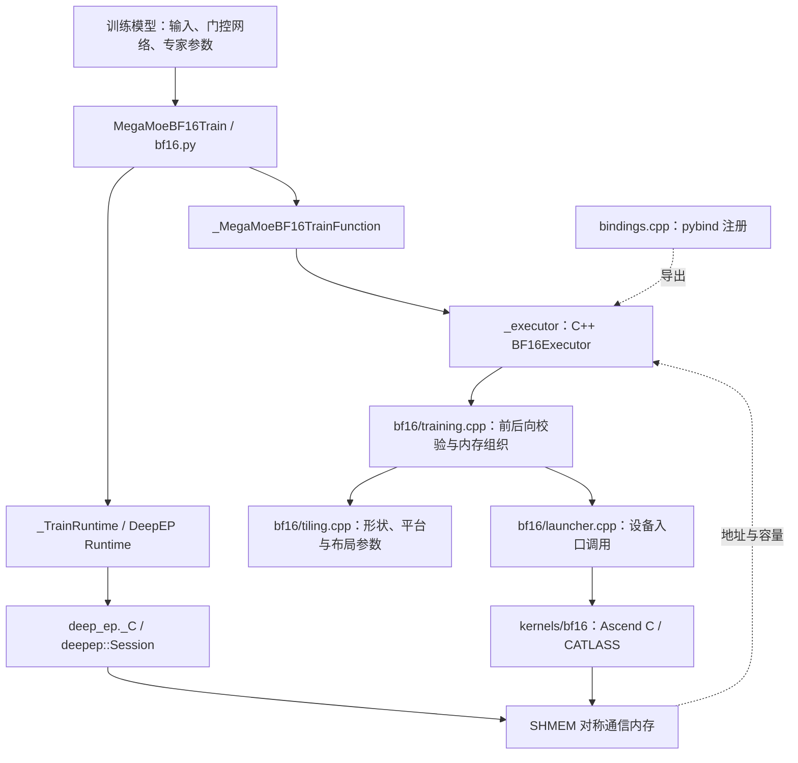
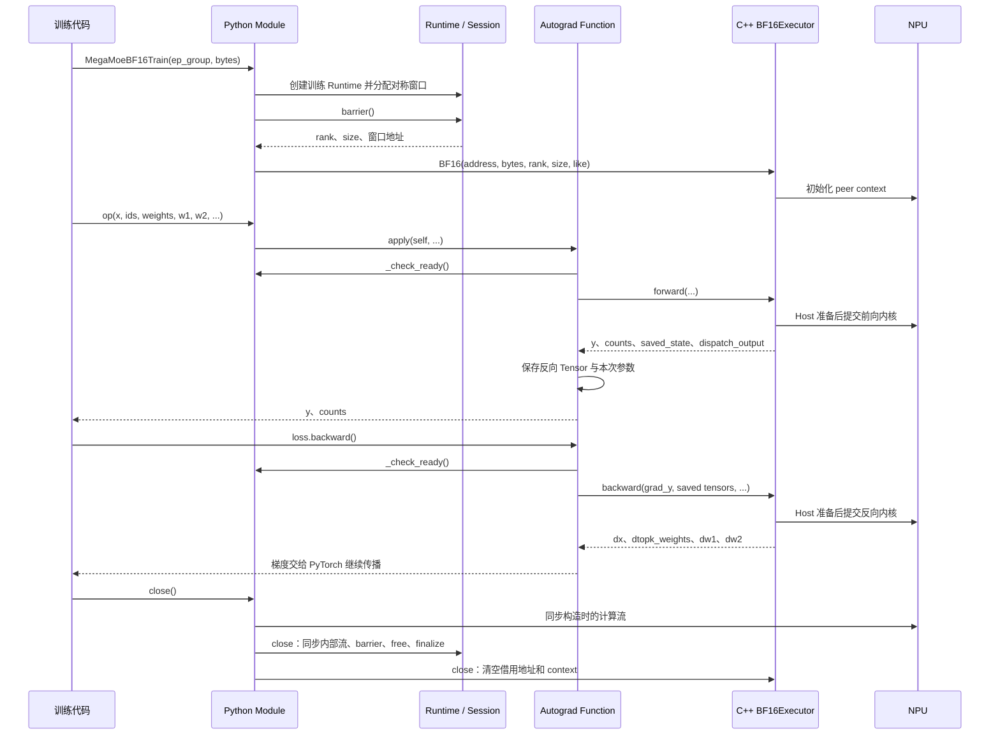

# MegaMoE BF16 训练框架设计

更新日期：2026-10-30。本文描述 `experiments/megamoe_train` 中的 BF16 训练框架，包含对外接口、自动求导、Host / Kernel 分层及资源归属。算子来源固定在 `b8cff14854d12aef77b6ae54b5890123759b4d28`。

本文主要解释对外接口、代码分层、PyTorch 自动求导桥接、通信资源和内存生命周期。设备内部的流水同步、tile 调度及数值舍入细节由对应实现和专题文档说明。以下描述以当前代码为准，历史迁移记录中的旧接口不应当作当前调用方式。

框架由三条关系组织：Python / C++ / Kernel 的计算调用链、autograd 管理的单次前向状态，以及 Runtime / Session 管理的模块级通信资源。调用方看到的是 `op(...) → loss.backward() → op.close()`；专家参数由模型持有，通信窗口由根 Session 持有。

## 1. 在训练框架中的位置

`MegaMoeBF16Train` 是一个带通信状态的 `torch.nn.Module`。上游训练代码提供输入、已选出的专家 ID、路由权重和本 rank 的专家参数；算子完成路由重排、专家间通信和两层专家计算，并通过自定义自动求导返回梯度。

模型参数仍由训练模型持有。这个模块没有在内部注册 `w1/w2` 参数，也不创建优化器或执行数据并行梯度归约。上游门控网络可以通过 `topk_weights` 的梯度继续反向传播；离散的 `topk_ids` 不提供梯度。



三类状态决定了框架结构：

| 状态 | 生命周期 | 管理者 |
| --- | --- | --- |
| 模型输入和专家参数 | 由训练模型与计算图决定 | 调用方 / PyTorch |
| 通信 Session、对称内存和执行器 context | 从构造到显式 `close()` | Python 模块协调，Runtime 和执行器分别管理 |
| 单次前向的反向状态 | 从本次前向到对应计算图释放 | PyTorch autograd context |

## 2. 对外接口与数据契约

唯一的包级训练接口是 `MegaMoeBF16Train`：

```python
from deep_ep_experimental.megamoe_train import MegaMoeBF16Train

# 调用方已创建 EP group，并为每个进程选好本地 NPU。
# DEEPEP_SHMEM_ENDPOINT 已设置为各 rank 一致的独立 bootstrap 地址。
op = MegaMoeBF16Train(
    ep_group,
    local_mem_size,
    timeout=120,
)

y, counts = op(
    x, topk_ids, topk_weights, w1, w2,
    max_recv_tokens,
    swiglu_limit=0.0,
    save_gmm1_output="bf16",
)
loss = (y * grad_y).sum()  # 示例；真实训练使用模型自己的 loss。
loss.backward()
op.close()
```

构造函数为 `__init__(ep_group, local_mem_size, *, timeout=120)`。计算接口为 `forward(x, topk_ids, topk_weights, w1, w2, max_recv_tokens, *, swiglu_limit=0.0, save_gmm1_output="bf16")`。

令 `M` 为当前 rank 的输入 token 数，`H` 为 hidden 维，`F` 为专家中间维，`T` 为每个 token 的路由数量，`E` 为每个 rank 的本地专家数，`EP` 为进程组大小。

| 参数或返回值 | 类型 / 形状 | 含义 |
| --- | --- | --- |
| `ep_group` | 已有 ProcessGroup 或 StoreGroup | 提供 EP rank 和 group size，并协调初始化；不能为 `None` |
| `local_mem_size` | 正整数，字节 | 当前 rank 的对称通信窗口容量，至少 2 MiB，按 2 MiB 对齐 |
| `timeout` | 整数，1..3600 秒 | 传给共享 Runtime / Session 的 SHMEM 初始化和控制操作超时；group 自身超时由调用方设置 |
| `x` | BF16 `[M,H]` | 当前 rank 的 token 输入 |
| `topk_ids` | int32 `[M,T]` | 全局专家编号，按 `ep_rank * E + local_expert` 解释 |
| `topk_weights` | BF16 `[M,T]` | 对应路由的权重，可参与求导 |
| `w1` | BF16 `[E,2F,H]` | 本 rank 专家的第一层权重 |
| `w2` | BF16 `[E,H,F]` | 本 rank 专家的第二层权重 |
| `max_recv_tokens` | 正整数，最多 int32 上界 | 当前 rank 所有本地专家合计接收的路由行容量；一条 token 路由对应一行 |
| `swiglu_limit` | 可表示为 float32 的有限数值 | `<=0` 关闭 clipping；正数作为 SwiGLU 截断参数 |
| `save_gmm1_output` | `bf16 / none / mxfp8 / auto` | 控制反向使用的 Gate/Up 保存形式 |
| `y` | BF16 `[M,H]` | combine 回当前源 rank 的输出 |
| `counts` | int32 `[E]` | 当前 rank 各本地专家的接收 token 数，不参与求导 |

所有输入 Tensor 应为连续布局，位于构造时的同一 NPU。兼容旧权重布局 `w1=[E,H,2F]`、`w2=[E,F,H]`；Host 根据形状识别，权重梯度保持输入布局。

当前 Host 的形状边界包括：`M<=16384`、`E<=32`、`EP*E<=2048`、`H%256==0`、`F%256==0`，并要求维度为正、`T<=EP*E`。BF16 训练 Runtime 的代码范围为 `2<=EP<=1024`；当前 StoreGroup 自身限制 `size<=128`，因此通过 StoreGroup 使用时还要满足这一范围。这些是实现边界，实际设备与拓扑验证范围另见验证记录。

调用方保证专家 ID 合法、同一个 token 的专家 ID 不重复，并为接收的路由行提供足够容量。同一次集体计算中的各 rank 应使用相容的模型/路由布局、保存模式和操作顺序。构造时有跨 rank 配置协调；每次前后向没有全量路由数据校验或逐项跨 rank 参数协商。

## 3. 代码架构与阅读入口

`megamoe_train` 内部按训练变种组织实现。BF16 的 Python 模块、Host、设备代码和测试各有明确归属；扩展注册入口和通用错误检查留在顶层，各变种内部保持薄绑定与 Host/Kernel 分层。

后续量化训练算子也归入 `megamoe_train`，在对应层增加同级实现。当前只建立 BF16 的边界，不创建量化占位目录或公共执行器基类；等第二个真实实现落地后，再根据实际重复提取公共代码。BF16 的保存模式和调度策略仍属于本变种。

```text
experiments/megamoe_train/
├── python/deep_ep_experimental/megamoe_train/
│   ├── __init__.py                 包级导出
│   └── bf16.py                     BF16 Module、autograd 与生命周期协调
├── csrc/
│   ├── bindings.cpp                pybind 注册
│   ├── check.hpp                   ACL / SHMEM 错误检查辅助
│   ├── bf16/
│   │   ├── training.hpp / training.cpp 执行器、结果类型及 Host 前后向
│   │   ├── tiling.hpp / tiling.cpp     tiling 与通信/工作区容量计算
│   │   ├── tiling_impl.hpp             Host tiling 与容量计算内部实现
│   │   ├── launcher.hpp / launcher.cpp context 初始化与 Tensor 到原始地址的桥接
│   │   └── kernel_launch.hpp           Host / Device 共享的 C 入口声明
│   └── kernels/bf16/
│       ├── mega_moe_bf16_forward.cpp  前向设备入口
│       ├── mega_moe_bf16_backward.cpp 反向设备入口
│       ├── mega_moe_bf16_forward.hpp   前向主控类
│       ├── mega_moe_bf16_backward.hpp  反向主控类
│       ├── catlass/               前后向 GEMM 适配与 L0C → UB 拷贝扩展
│       ├── epilogue/              SwiGLU 前后向与 saved-MXFP8
│       ├── layout/                布局契约、地址视图与 context
│       ├── schedule/              就绪判断、生产阶段与 tile 调度
│       ├── routing/               初始化路由、权重收集、combine 与 unpermute
│       │   └── moe_init_routing_v3/arch35/  引入的路由初始化实现
│       └── common/                共享 tiling 数据、常量、拷贝与 op_kernel 辅助
├── tests/bf16/
│   ├── test_mega_moe.py           前向精度 / 性能入口
│   ├── test_mega_moe_backward.py  反向精度入口
│   ├── mega_moe_bf16_golden.py    NumPy 前向参考
│   └── 其他辅助与回归            数据、启动、接口、布局及调度检查
├── tests/integration/
│   └── bf16_lifecycle.py          多次调用、流和关闭重建检查
├── benchmarks/paired.py           历史迁移性能对照工具
├── CMakeLists.txt                 可选训练扩展构建
├── upstream.json                  来源文件映射与原始 SHA
└── docs/                          数值与调度专题说明
```

| 阅读入口 | 主要职责 |
| --- | --- |
| [bf16.py](../../experiments/megamoe_train/python/deep_ep_experimental/megamoe_train/bf16.py) | 对外参数、autograd 保存/恢复状态、构造与关闭 |
| [bindings.cpp](../../experiments/megamoe_train/csrc/bindings.cpp) | 将 C++ 执行器注册为 `_C.BF16`，绑定命名结果类型 |
| [training.hpp](../../experiments/megamoe_train/csrc/bf16/training.hpp) | `ForwardResult`、`BackwardResult`、`BF16Executor` 及 Host 函数声明 |
| [training.cpp](../../experiments/megamoe_train/csrc/bf16/training.cpp) | Tensor 校验、权重布局识别、内存分配、执行器实现和流记录 |
| [tiling.cpp](../../experiments/megamoe_train/csrc/bf16/tiling.cpp) | 查询平台资源，解析保存模式，生成 tiling 并计算容量 |
| [launcher.cpp](../../experiments/megamoe_train/csrc/bf16/launcher.cpp) | 建立 peer context，取得当前流，调用设备入口 |
| [kernel_launch.hpp](../../experiments/megamoe_train/csrc/bf16/kernel_launch.hpp) | 共享设备库的导出函数签名 |
| [Runtime](../../deep_ep/_runtime.py) / [Session](../../csrc/runtime/session.cpp) | 共享的进程级通信资源管理 |

建议按 `bf16.py → training.hpp → bindings.cpp → training.cpp → launcher.cpp → 设备入口` 阅读；需要理解容量和保存状态时再进入 tiling 与 workspace 定义。

设备实现直接放在 `kernels/bf16/` 下，按职责分组，不再增加私有 `include/` 层。根目录只保留前后向设备入口、主控类和 README；路由、调度、GEMM、epilogue 和布局进入对应子目录。项目维护的 C++ / Ascend C 头文件统一使用 `.hpp`；`common/op_kernel/` 和 `routing/moe_init_routing_v3/arch35/` 中引入的 SDK 头保留原始 `.h` 文件名。Host 专用的 tiling 内部实现放在 `csrc/bf16/tiling_impl.hpp`，Host/Device 共享的 tiling 数据仍放在设备目录的 `common/`。

设备侧 `layout/mega_moe_layout.hpp` 定义 Host/Device 共用的布局公式；`layout/mega_moe_workspace_view.hpp` 将基址和布局映射为设备地址视图，包含 `ForwardWorkspaceInfo`、反向视图及 `PeermemInfo`；`layout/mega_moe_context.hpp` 保留通信 context、地址句柄和共享 Params。Host 侧同名的 `WorkspaceInfo` 是容量计算结果类型，保持原名。

纯前向实现与对应反向实现采用一致的命名格式，包括 `MegaMoeBF16Forward / MegaMoeBF16Backward`、前后向 CATLASS namespace 和 SwiGLU epilogue。共享 Params、`MegaMoeBF16Impl` namespace 和整个训练模块的名称保持不变。现有阶段与调度头保留原粒度，本轮不创建 `stage/`。

## 4. Python 层如何接入自动求导

### 4.1 模块负责协调，不持有专家参数

`MegaMoeBF16Train` 的主要成员为：

| 成员 | 含义 |
| --- | --- |
| `_runtime` | `_TrainRuntime` 实例，拥有根 Session 的 Python 生命周期 |
| `_executor` | `_C.BF16`，即 C++ `BF16Executor`；持有设备 context，借用通信窗口 |
| `_npu` | NPU API 访问入口 |
| `_stream` | 构造时的计算流，前后向必须使用这条流 |
| `_closed` | 模块自身的显式关闭状态 |

模块的 `forward()` 检查接收容量、clipping 数值和保存模式，然后调用 `_MegaMoeBF16TrainFunction.apply(self, ...)`。

### 4.2 `op` 与 `_executor` 的关系

自动求导函数中的 `op` 就是外层 Python `MegaMoeBF16Train` 实例。`op._executor` 是它持有的底层 C++ 执行对象。`ctx.op = op` 保存同一个 Python 对象的引用，供反向继续检查状态、访问 Runtime 和调用执行器；这里不会创建第二个训练模块。

自动求导桥接接收 Python 实例的原因，是让前后向共同调用 `_check_ready()`。原仓实现向 Function 分别传入 C++ 算子和 shmem；当前通信资源改由 DeepEP Runtime 管理，因此保留 Python 实例作为统一访问入口。

### 4.3 单次计算图保存什么

前向通过 `ctx.save_for_backward()` 保存六个 Tensor：

```text
(topk_weights, w1, w2, counts, saved_state, dispatch_output)
```

另外保存 `max_recv_tokens`、`swiglu_limit` 和本次请求的保存模式，使反向使用对应前向的配置。`counts` 使用 `mark_non_differentiable()` 标记为无梯度。

Python 不重新解码设备 saved-state，也不维护一份独立的布局或量化模式镜像。布局与模式解析在 Host / Device 公共定义中完成。原始 `x` 和 `topk_ids` 不作为额外 Tensor 放进 `save_for_backward()`；当前反向依赖的是保存的 dispatch payload 和路由元数据。

### 4.4 梯度如何返回

`loss.backward()` 调用 Function 的 `backward()`，将连续的 `grad_y`、上述六个 Tensor 和本次参数传给 C++ 执行器。

| Function 前向输入 | 反向返回 |
| --- | --- |
| `op` | `None` |
| `x` | `dx` |
| `topk_ids` | `None` |
| `topk_weights` | `dtopk_weights` |
| `w1` | `dw1` |
| `w2` | `dw2` |
| `max_recv_tokens / limit / mode` | 各自为 `None` |

Function 有九个输入，所以返回九个对应位置。PyTorch 根据 `requires_grad` 将梯度继续传递给上游；C++ 当前返回完整的四类梯度，没有按单个输入的求导需求选择不同计算路径。`@once_differentiable` 明确当前不支持二阶求导。

## 5. 从构造到关闭的调用链



### 5.1 构造阶段

1. 调用方先选定本地 NPU，并传入非空 EP group。
2. `_TrainRuntime` 用 `_megamoe_train=True` 选择根扩展的 `create_megamoe_train_runtime` 工厂。
3. 共享 Runtime 协调各 rank 的容量、超时、bootstrap 地址及设备映射，执行进程内互斥检查，然后创建 C++ Session。
4. Session 使用 MTE/default 初始化 SHMEM，申请并清零对称窗口。调用方传入的 group 用于初始化协调，实际 token/梯度通信由设备内核访问 SHMEM 完成。
5. Python 执行 barrier，确保所有 peer 的初始化完成。
6. 通过根扩展的 `megamoe_train_workspace_address()` 取得地址。执行器核对 rank/size、窗口容量与对齐，建立持久 context。

`DEEPEP_SHMEM_ENDPOINT` 是独立的 SHMEM bootstrap 地址，不应与训练框架已有的 rendezvous 或测试协调服务争用同一监听端口。

### 5.2 前向阶段

`training.cpp` 识别权重布局、检查形状和 dtype，经 `tiling.cpp` 生成平台与布局参数，检查对称窗口能否容纳本次通信数据，再分配输出、持久保存状态和临时 workspace。

逻辑数据流为：

```text
输入 token 与路由 → 重排/dispatch → GMM1 → SwiGLU/clipping
                → 路由权重作用于专家激活 → GMM2 → combine/unpermute → y
```

这些步骤由设备实现融合和流水执行。框架层只负责契约与资源组织，不在 Python 中拆开执行这些计算。

### 5.3 反向阶段

Host 从保存状态恢复本次计算需要的布局，分配四类梯度和反向 workspace。设备重新分发输出梯度，使用保存的 Gate/Up 或按模式重算 GMM1，然后计算激活梯度、输入梯度、路由权重梯度和两层权重梯度。

`dispatch_output` 提供接收后的 packed token 与路由权重，`saved_state` 提供路由元数据和可选 Gate/Up。因此当前反向要求它们始终保留到对应 backward；公共接口没有“提前丢弃这些数据”的开关。

### 5.4 关闭阶段

`close()` 按顺序执行：

```text
检查是否已经关闭
→ 检查 Runtime / 当前设备
→ 同步 _stream
→ Runtime.close()
→ BF16Executor.close()
→ 设置模块 _closed=True
```

Session 的关闭包含跨 rank barrier、释放通信窗口和 SHMEM finalize。执行器的关闭只清空借用地址并释放自己的 context，不再次销毁 SHMEM。调用方仍拥有 EP group，须在算子关闭后再销毁 group。成功关闭后的重复 `close()` 直接返回。

当前没有 pending/lease 机制，不检查还剩多少未消费的计算图。调用方负责完成所需的所有 backward，再由所有 rank 按一致顺序关闭。关闭后再次前向或反向会被状态检查拒绝。Python GC 不执行集体清理；不能用对象析构代替显式关闭。

## 6. 内存和资源归属

| 对象 | 分配 / 持有位置 | 生命周期与释放方式 |
| --- | --- | --- |
| 对称通信窗口 | 根 Session，通过 SHMEM 申请 | 模块级复用；Session 在显式关闭时释放 |
| `context_` | C++ 执行器，Torch UInt8 Tensor | 模块级复用；保存 rank/size 和各 peer 的窗口地址；执行器关闭时释放 |
| `y / counts` | Host 通过 Torch 分配 | 返回给调用方；counts 同时由计算图保存 |
| `saved_state` | Host 通过 Torch 分配 | 每次前向独立；计算图保存到对应反向需要结束 |
| `dispatch_output` | Host 通过 Torch 分配 | 每次前向独立；计算图保存 packed token 和路由权重 |
| 前向 transient workspace | Host 通过 Torch 分配 | 仅供本次前向使用，不作为结果返回或保存进计算图 |
| backward workspace | Host 通过 Torch 分配 | 仅供本次反向使用，不作为梯度结果返回 |
| `topk_weights / w1 / w2` | 调用方提供，计算图保留引用 | 在对应 backward 前保持有效，不应原地修改 |

`local_mem_size` 只描述通信窗口，不等于本算子的总显存占用。保存状态、输出和 scratch 是另外分配的 Torch Tensor。

`max_recv_tokens` 以路由行为单位，用于确定容量。以 `R=max_recv_tokens` 为例，当前 dispatch payload 的容量为 `align512(2*R*H) + align512(2*R)` 字节，分别存 BF16 packed token 和 BF16 packed 路由权重；这还不包含 saved-state、scratch 和 SHMEM 窗口。

多次前向会建立多个 autograd context，各自保留独立状态。可以按所有 rank 一致的顺序执行多个前向及其反向，但通信窗口和执行器 context 仍然共享，所有调用需要串行化。未完成的计算图越多，持久保存 Tensor 的占用也越大。

## 7. 保存模式与 clipping 的框架契约

| 模式 | 本次前向保存的 Gate/Up | 反向行为 |
| --- | --- | --- |
| `bf16` | BF16 Gate/Up | 直接使用保存值 |
| `none` | 不保存 Gate/Up 数据面 | 从 retained dispatch token 重算 GMM1；路由元数据和 dispatch payload 仍然保存 |
| `mxfp8` | MXFP8 Gate/Up；开启 clipping 时另有三个位平面 | 还原保存值，并结合 clip mask 计算梯度 |
| `auto` | 关闭 clipping 时选 MXFP8，开启时选 BF16 | 按解析后的模式执行 |

MXFP8 控制保存的激活格式，矩阵计算路径仍为 BF16。模式解析使用规范化后的 float32 limit；实现以 `FLT_MAX` 为关闭 clipping 的内部哨兵。Python 保存本次请求的 mode/limit，Host 在前后向按相同规则解析。

正数 limit 的计算语义是 `gate=min(gate,L)`、`up=clamp(up,-L,L)`。保存模式只改变需要跨前后向保留的数据，不改变外层 `(y, counts)` 和四类梯度的接口。

## 8. 设备、流与异步内存安全

当前 `_check_ready()` 在前后向都执行：

| 检查 | 当前实现 |
| --- | --- |
| 模块是否关闭 | 检查 `_closed` |
| Runtime 是否有效、当前 NPU 是否一致 | 调用 `_runtime.ensure_alive()` |
| 当前流是否为构造时的流 | 比较当前流和 `_stream` |

模块、Runtime 和 C++ 执行器分别维护自身的资源有效状态。Python 检查模块和 Runtime 的生命周期，执行器在关闭时清空借用的通信地址并释放 context。

需要区分两条流：`MegaMoeBF16Train._stream` 是实际提交训练计算的流；共享 Runtime 另外创建的内部流用于它的生命周期与同步管理。launcher 取得当前流提交训练内核，外层模块要求它等于 `_stream`。因此 `close()` 先等 `_stream`，再进入 Runtime 自己的关闭流程。

Host 在提交前后向后，对实际参与计算的 Tensor 调用 `NPUCachingAllocator::recordStream`，包括临时 workspace 和连续化后的梯度。这样 Tensor 的 Python/C++ 局部引用结束后，分配器仍会遵守异步使用关系。

流记录解决分配器复用问题；共享 context 和通信窗口的执行顺序依靠当前的同流串行约定。代码没有实现任意换流时的自动等待和依赖传递。调用方还需保证所有 EP rank 的操作次序相容；本地 ready 检查不会替其他 rank 协调失败处理。

## 9. 构建、绑定与推理模块的关系

存在两个不同的 `_C` 扩展：

| 扩展 | 角色 |
| --- | --- |
| `deep_ep._C` | 根 Runtime / Session，提供训练 Session 工厂与窗口地址 |
| `deep_ep_experimental.megamoe_train._C` | 训练 Tensor 接口，导出内部 `BF16` 执行器和命名结果类型 |

构建入口是根仓库，训练开关为 `DEEPEP_BUILD_MEGAMOE_TRAIN=ON`，默认关闭。训练子目录的 CMake 将四个 Host 源文件构建成训练 `_C`，并用 Bisheng 编译前后向设备入口，链接为 `libdeepep_megamoe_train_bf16.so`。两者安装在训练 Python 包目录，使用同目录的设备库。

依赖由根仓库锁定和记录，见 [dependencies.lock.json](../../dependencies.lock.json)。当前基线面向 Ascend950 / CANN 9.2.0，使用根仓库的 SHMEM 和 CATLASS，不再单独引入原仓的 ShmemInstance 生命周期。

| 维度 | 推理模块 | BF16 训练模块 |
| --- | --- | --- |
| Python 包 | `deep_ep_experimental.megamoe` | `deep_ep_experimental.megamoe_train` |
| Python 入口组织 | `api.py` | 按训练变种分模块，当前为 `bf16.py` |
| 绑定与 Host 分层 | 薄绑定 + `forward.hpp/.cpp` | 薄绑定 + `bf16/training.hpp/.cpp` |
| 原生执行对象 | 推理 Plan | BF16Executor，提供前向和反向 |
| 训练图状态 | 推理接口不提供训练反向 | 按每次前向保存 autograd 状态 |
| 设备库 / 构建开关 | 独立推理组件 | 独立训练组件 |
| Timer | 推理有可选 timer | 训练公共接口没有 timer 参数 |

两者复用 Runtime 基础设施，但不会在一个进程内并行持有两个独立 SHMEM Session。构建时可同时打包多个可选组件；运行时受共享 Runtime 的互斥约束。

当前训练扩展保留内部 `forward/backward/close`，外层使用 `op(...) / loss.backward() / op.close()`。旧的 `compute`、`compute_train`、`backward_debug`、Diagnostics、定制 `abi_version` 检查及 pending/lease 已从这套训练接口移除；结果结构直接定义在 `bf16/training.hpp`。

## 10. 测试入口与来源维护

| 文件 | 职责 |
| --- | --- |
| [test_mega_moe.py](../../experiments/megamoe_train/tests/bf16/test_mega_moe.py) | 前向精度和性能，按 CSV 配置 shape，检查输出与专家计数 |
| [test_mega_moe_backward.py](../../experiments/megamoe_train/tests/bf16/test_mega_moe_backward.py) | 执行公共前后向接口，使用脚本内的 NumPy reference_backward 检查四类梯度和专家计数 |
| [mega_moe_bf16_golden.py](../../experiments/megamoe_train/tests/bf16/mega_moe_bf16_golden.py) | 前向参考计算及可见 BF16 舍入边界 |
| [test_training_api.py](../../experiments/megamoe_train/tests/bf16/test_training_api.py) | 对外签名、参数校验和保存模式透传 |
| [bf16_lifecycle.py](../../experiments/megamoe_train/tests/integration/bf16_lifecycle.py) | 设备上的多次调用、流约束、权重布局和关闭重建 |
| [upstream.json](../../experiments/megamoe_train/upstream.json) / [check_source_import.py](../../experiments/megamoe_train/scripts/check_source_import.py) | 原始来源 SHA、source/target 映射和必需文件存在性检查 |

当前前向脚本支持 `precision / performance / both`，反向脚本提供梯度精度验证。输入、golden 缓存、启动协调和原仓性能对照保留各自的现有辅助实现；本次结构整理只更新受影响的文件引用，不调整数据生成、误差阈值或运行模式。

来源清单保留固定算子源提交、各文件的原始 SHA 和 source/target 映射，局部命名与目录调整记录在 adaptation 中。来源检查只验证来源声明及所需文件是否存在，不比较当前源码与源版本的计算内容，也不代替构建或设备验证。

本轮执行本地语法、引用、来源、格式检查及受影响的 Python 回归。新的前向内核符号要求 Host/Device 联合重建；设备构建、数值与性能验证留到具备相应环境的机器执行，不据此声明精度或性能通过。历史设备结果参见 [首轮迁移验收记录](首轮迁移验收.md)，应按其中的源码版本与环境理解。
